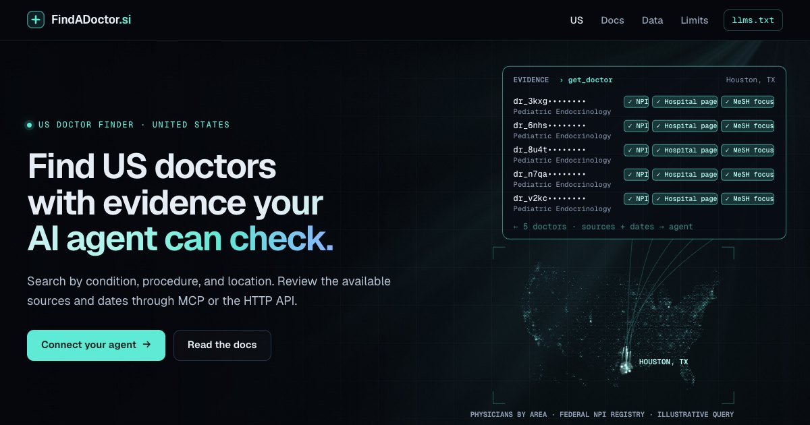

# FindADoctor.si MCP server

**Find US doctors for a condition, procedure or place, with sourced evidence for each doctor. Built for AI agents. No sign-up.**

[](https://findadoctor.si/us/)

```text
https://api.findadoctor.si/mcp
```

FindADoctor.si is a remote MCP server (Streamable HTTP) and a plain HTTP API. An agent asks for "doctors near Phoenix who do a lot of AFib ablations" and gets a short list, then opens the evidence: Medicare procedure volumes with national ranks, registered specialty, medical school, hospital affiliations, focus areas from the doctor's hospital website, phones with where they came from, and warnings such as the federal exclusion list or Medicare opt-out.

This repository is the official guide for connecting to the service: setup for each client, the tool reference, examples and an Agent Skill. The server code and the database are not open source and are not in this repository.

- Website: https://findadoctor.si
- Docs: https://findadoctor.si/us/docs/
- For agents: [`/llms.txt`](https://findadoctor.si/llms.txt) · [`openapi.json`](https://api.findadoctor.si/openapi.json) · [MCP server card](https://api.findadoctor.si/mcp/server-card)
- MCP Registry: `si.findadoctor.api/us-doctor-finder` ([entry](https://registry.modelcontextprotocol.io/v0.1/servers/si.findadoctor.api%2Fus-doctor-finder/versions/latest))

> Not medical advice. In an emergency, call 911.

## What an agent can answer with it

- "Who near Phoenix does the most atrial fibrillation ablations? My father is 70."
- "My 9-year-old was just diagnosed with type 1 diabetes. We live in Houston. Which pediatric endocrinologists focus on it?"
- "Is Dr. X really a hand surgeon, and where did they train?"
- "Find rheumatologists within 10 miles of ZIP 60601 whose hospital pages say they speak Spanish."
- "Which knee replacement surgeons in Ohio have the highest Medicare volume?"

## Connect

No sign-in, no API key. Point any MCP client that supports remote servers at the URL above.

| Client | How |
|---|---|
| Claude (claude.ai, Claude Desktop) | Customize → Connectors → + Add → Add custom connector → paste the URL → Continue → Authentication: No sign in |
| ChatGPT | Where your plan allows custom MCP servers: Plugins → + → Add custom MCP server → paste the URL → no authentication |
| Claude Code | `claude mcp add --transport http findadoctor https://api.findadoctor.si/mcp` |
| Codex CLI | `codex mcp add findadoctor --url https://api.findadoctor.si/mcp` |
| Gemini CLI | `gemini mcp add --transport http findadoctor https://api.findadoctor.si/mcp` |
| Cursor | `{"mcpServers": {"findadoctor": {"url": "https://api.findadoctor.si/mcp"}}}` in `~/.cursor/mcp.json` |
| VS Code | `{"servers": {"findadoctor": {"type": "http", "url": "https://api.findadoctor.si/mcp"}}}` in `.vscode/mcp.json` |
| No MCP? | Use the HTTP API: `GET https://api.findadoctor.si/api/v1/search?...` (see below) |

Step-by-step instructions, with links to each client's own guide: [docs/connect.md](docs/connect.md).

## How it works

Two steps:

1. **`search_doctors`**: a free short list for a need (condition, procedure, specialty, place or name). It tells you who the doctors are and what evidence each one has, not the evidence itself.
2. **`get_doctor`**: the evidence for up to 10 doctors per call. This is counted per day, so open only the doctors you are seriously considering. One reply holds about 2–3 doctors; the rest come back under `not_returned_yet`, already counted, so ask again for them at no extra cost.

| MCP tool | HTTP API | What it does |
|---|---|---|
| `search_doctors` | `GET /api/v1/search` | Free short list for a need. |
| `get_doctor` | `GET /api/v1/doctors?ids=…` | Evidence for up to 10 doctors, or one by `npi`. Counted per day. |
| `lookup_terms` | `GET /api/v1/terms?text=…` | How a word is understood: MeSH conditions, procedure groups, specialties. |
| `list_procedures` | `GET /api/v1/procedures` | The 81 procedure groups with Medicare 2024 volumes. |
| `list_specialties` | `GET /api/v1/specialties` | Specialty names and ids. |
| `about_database` | `GET /api/v1/about` | Sources, build date, coverage, scoring and caveats. |

Every parameter and field: [docs/tools.md](docs/tools.md), [`reference/tools.json`](reference/tools.json) and [`openapi.json`](https://api.findadoctor.si/openapi.json).

### Example

```bash
curl -s "https://api.findadoctor.si/api/v1/search?condition=atrial%20fibrillation&city=Phoenix&state=AZ&within_miles=25&medicare_patient=true"
```

Trimmed reply (names, ids, phones and addresses in this repository are made up):

```json
{
  "total_matches": 436,
  "results": [
    {
      "rank": 1,
      "doctor_id": "dr_example00001",
      "name": "Jordan Example",
      "degree": "MD",
      "specialty": "Cardiac Electrophysiology",
      "city": "Phoenix",
      "state": "AZ",
      "distance_miles": 4.2,
      "match_basis": "direct_evidence",
      "detail_has": ["hospital_website_profile", "procedure_volume_for_this_need", "many_patients_with_this_condition", "phone", "new_patient_status", "languages"]
    }
  ],
  "next_step": "Call get_doctor with doctor_ids (up to 10 at once) for the doctors you are considering. …"
}
```

Then open the evidence:

```bash
curl -s "https://api.findadoctor.si/api/v1/doctors?ids=dr_example00001"
```

Full sample replies: [examples/responses](examples/responses). Runnable examples: [curl](examples/curl), [Python](examples/python), [TypeScript](examples/typescript).

## Limits

As of 2026-10-13, during the public test. The current values are always on the [Limits page](https://findadoctor.si/us/docs/limits/).

| | Without an account | With an account key |
|---|---|---|
| Different doctors opened with `get_doctor` per day | 5 per network address | 100 |
| Requests per minute | 30 | 60 |
| Requests per day | 300 | 1,000 |

- Searching does not count toward the doctor allowance. Opening the same doctor again the same UTC day is free.
- Connections from the Claude and ChatGPT apps, recognized by the network addresses Anthropic and OpenAI publish, have their own allowances (ChatGPT: 100 per user; Claude: one shared allowance for all its users). See [`/llms.txt`](https://api.findadoctor.si/llms.txt).
- When the allowance runs out, the reply says so and when it resets (00:00 UTC). An agent should tell the person, not retry in a loop.
- Need more? Email contact@findadoctor.si with what your agent does to ask for an account key (sent as `Authorization: Bearer`).

## Data

About 1.2 million US physicians with official records. About 280,000 of them also have facts from their hospital system's own website (about 82,000 with listed focus areas, as standard MeSH terms).

Sources: NPPES NPI registry, the CMS Doctors and Clinicians file, Medicare Physician & Other Practitioners 2024, Medicare Part D Prescribers 2024, CMS Open Payments 2024–2025, the CMS Provider Data Catalog, the OIG exclusion list, CMS Medicare opt-out affidavits, NLM MeSH, the NUCC taxonomy, the US Census Gazetteer, and hospital systems' own find-a-doctor pages. Every evidence line in a reply names its source and date. Details: [Data and sources](https://findadoctor.si/us/docs/data/).

What it does **not** have:

- Insurance network checks. Confirm a plan on the insurer's directory or with the office.
- Appointment availability.
- Patient reviews or outcome measures for individual doctors. The only quality figure is the CMS MIPS 2024 score, usually reported for the whole practice group. Hospital affiliations show the CMS hospital star rating.
- Any patient records.

Rankings show evidence of focus and experience for a need, not quality of care. No private doctor rating, award or hospital ranking is included or counted. The hospital and children's hospital websites we read were chosen partly from published lists.

## Agent Skill

[`skills/findadoctor`](skills/findadoctor/SKILL.md) is an [Agent Skill](https://agentskills.io) that tells an agent when and how to use the service. It covers what to ask the person, `medicare_patient` for anyone 65 or older, what to confirm before booking, and how to say what the data can't show. It works with the MCP tools or, without MCP, with the HTTP API. Copy the folder into `~/.agents/skills/` or your client's own skills folder (for Claude Code: `~/.claude/skills/`).

## Privacy

Search terms are used only to answer the request. They are not logged or stored, and they are not used to train AI models. Agents should not send a person's name, date of birth or insurance member ID. Full policy: [Privacy](https://findadoctor.si/privacy/).

## Corrections, support and security

- **Doctors:** if something about you is wrong, see [Corrections and removal](https://findadoctor.si/us/corrections/). Please don't use GitHub issues for personal details.
- **Bugs in replies, docs or examples:** [open an issue](https://github.com/simonlin1212/findadoctor-mcp/issues/new/choose). Leave out anything about a patient.
- **Security:** see [SECURITY.md](SECURITY.md).
- **Email:** contact@findadoctor.si

## License

The contents of this repository (docs, examples, the Agent Skill) are MIT licensed. The license does not cover the service, its data, or the FindADoctor.si and Phoenix Tree names and logos. Use of the service and its data is governed by the [Terms of use](https://findadoctor.si/terms/).

Operated by Phoenix Tree (Phoenix Tree AI).
