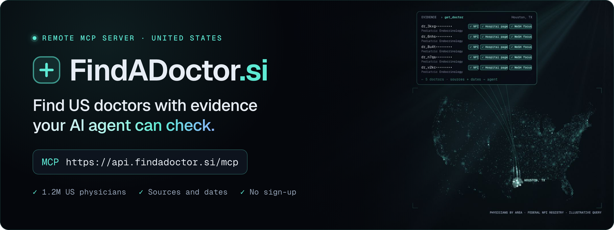

<p align="center">
  <a href="https://findadoctor.si/us/"></a>
</p>

<h1 align="center">FindADoctor.si MCP server</h1>

<p align="center">
  <b>Find doctors for a condition, procedure or place, with sourced evidence for each doctor.</b><br>
  Remote MCP servers and HTTP APIs built for AI agents, one per country: the United States and New Zealand. No sign-up, no API key.
</p>

<p align="center">
  <a href="https://registry.modelcontextprotocol.io/v0.1/servers/si.findadoctor.api%2Fus-doctor-finder/versions/latest"></a>
  <a href="https://registry.modelcontextprotocol.io/v0.1/servers/si.findadoctor.api-nz%2Fnz-doctor-finder/versions/latest"></a>
  
  
  <a href="https://findadoctor.si"></a>
  <a href="LICENSE"></a>
</p>

<p align="center">
  <a href="https://cursor.com/install-mcp?name=findadoctor&config=eyJ1cmwiOiJodHRwczovL2FwaS5maW5kYWRvY3Rvci5zaS9tY3AifQ%3D%3D"></a>
  <a href="https://vscode.dev/redirect/mcp/install?name=findadoctor&config=%7B%22type%22%3A%22http%22%2C%22url%22%3A%22https%3A%2F%2Fapi.findadoctor.si%2Fmcp%22%7D"></a>
  <a href="#claude-code"></a>
  <a href="#codex-cli"></a>
  <a href="#gemini-cli"></a>
</p>

<p align="center">
  <a href="https://findadoctor.si/us/docs/"><b>Docs</b></a> ·
  <a href="docs/connect.md"><b>Connect guide</b></a> ·
  <a href="docs/tools.md"><b>Tool reference</b></a> ·
  <a href="https://findadoctor.si/llms.txt"><b>llms.txt</b></a> ·
  <a href="https://api.findadoctor.si/openapi.json"><b>OpenAPI</b></a> ·
  <a href="https://api.findadoctor.si/mcp/server-card"><b>Server card</b></a>
</p>

> [!IMPORTANT]
> Not medical advice. In an emergency, call 911 in the United States or 111 in New Zealand.

## Quick start

United States:

```text
https://api.findadoctor.si/mcp
```

New Zealand ([details below](#new-zealand)):

```text
https://api-nz.findadoctor.si/mcp
```

Paste a URL into any MCP client that supports remote servers. There is no sign-in and no key. Most of this page is about the US server; the New Zealand server works the same way with its own tools. Or let your agent set it up; paste this into it:

```text
Connect the FindADoctor.si MCP servers to this client: https://api.findadoctor.si/mcp
(US) and https://api-nz.findadoctor.si/mcp (New Zealand), both Streamable HTTP, no
authentication. Read https://findadoctor.si/llms.txt first. If this client supports Agent
Skills, also install the findadoctor skill from
https://github.com/simonlin1212/findadoctor-mcp/tree/main/skills/findadoctor
```

## ❌ Without / ✅ With FindADoctor.si

Ask an agent that has only web search: *"Who near Phoenix does a lot of AFib ablations? My father is 70."* It has to piece an answer together from hospital marketing pages, review sites and directories:

- ❌ No way to tell who actually does the procedure often
- ❌ Rarely a check against the Medicare opt-out list or the federal exclusion list, which matters for a 70-year-old on Medicare
- ❌ A confident list that can't say where each claim came from

With FindADoctor.si, the same agent gets:

- ✅ Medicare 2024 procedure volumes with national ranks, for 81 procedure groups
- ✅ Focus areas from the doctor's own hospital-system page, as standard MeSH terms
- ✅ Registered specialty, medical school and hospital affiliations
- ✅ Warnings for the Medicare opt-out list and the OIG exclusion list
- ✅ A source and date on every evidence line, and phones that say where they came from

The database can't confirm insurance, and only some hospital pages list languages and new-patient status; each search reply tells the agent to check those on the web or with the office.

### Try asking

```text
Who near Phoenix does the most atrial fibrillation ablations? My father is 70.
```

```text
My 9-year-old was just diagnosed with type 1 diabetes. We live in Houston.
Which pediatric endocrinologists focus on it?
```

```text
Find rheumatologists within 10 miles of ZIP 60601 whose hospital pages say they speak Spanish.
```

More: "Is Dr. X really a hand surgeon, and where did they train?" · "Which knee replacement surgeons in Ohio have the highest Medicare volume?"

## Connect

No sign-in, no API key. Point any MCP client that supports remote servers at the URL above.

| Client | How |
|---|---|
| Claude (claude.ai, Claude Desktop) | Customize → Connectors → + Add → Add custom connector → paste the URL → Continue → Authentication: No sign in |
| ChatGPT | Where your plan allows custom MCP servers: Plugins → + → Add custom MCP server → paste the URL → no authentication |
| Claude Code | `claude mcp add --transport http findadoctor https://api.findadoctor.si/mcp`, or the [plugin](#claude-code) |
| Codex CLI | `codex mcp add findadoctor --url https://api.findadoctor.si/mcp`, or the [plugin](#codex-cli) |
| Gemini CLI | `gemini mcp add --transport http findadoctor https://api.findadoctor.si/mcp`, or the [extension](#gemini-cli) |
| Cursor | The **Add to Cursor** button above, or `{"mcpServers": {"findadoctor": {"url": "https://api.findadoctor.si/mcp"}}}` in `~/.cursor/mcp.json` |
| VS Code | The **Add to VS Code** button above, or `{"servers": {"findadoctor": {"type": "http", "url": "https://api.findadoctor.si/mcp"}}}` in `.vscode/mcp.json` |
| No MCP? | Use the HTTP API: `GET https://api.findadoctor.si/api/v1/search?...` (see below) |

Step-by-step instructions, with links to each client's own guide: [docs/connect.md](docs/connect.md).

### Install as a plugin

This repository is also a plugin: one install adds the MCP server and the [`findadoctor` Agent Skill](#agent-skill) together.

#### Claude Code

```bash
claude plugin marketplace add simonlin1212/findadoctor-mcp
claude plugin install findadoctor@findadoctor
```

#### Codex CLI

```bash
codex plugin marketplace add simonlin1212/findadoctor-mcp
codex plugin add findadoctor@findadoctor
```

#### Gemini CLI

```bash
gemini extensions install https://github.com/simonlin1212/findadoctor-mcp
```

Other clients that read [Agent Plugins](https://agent-plugins.org) can use [`plugin.json`](plugin.json), [`mcp.json`](mcp.json) and [`skills/`](skills/) from this repository.

## How it works (United States)

Two steps:

1. **`search_doctors`**: a free short list for a need (condition, procedure, specialty, place or name). It tells you who the doctors are and what evidence each one has, not the evidence itself.
2. **`get_doctor`**: the evidence for up to 10 doctors per call. This is counted per day, so open only the doctors you are seriously considering. One reply holds about 2–3 doctors; the rest come back under `not_returned_yet`, already counted, so ask again for them at no extra cost.

| MCP tool | HTTP API | What it does |
|---|---|---|
| `search_doctors` | `GET /api/v1/search` | Free short list for a need. |
| `get_doctor` | `GET /api/v1/doctors?ids=…` | Evidence for up to 10 doctors, or one by `npi`. Counted per day. |
| `lookup_terms` | `GET /api/v1/terms?text=…` | How a word is understood: MeSH conditions, procedure groups, specialties. |
| `list_procedures` | `GET /api/v1/procedures` | The 81 procedure groups with Medicare 2024 volumes. |
| `list_specialties` | `GET /api/v1/specialties` | Specialty names and ids. |
| `about_database` | `GET /api/v1/about` | Sources, build date, coverage, scoring and caveats. |

Every parameter and field: [docs/tools.md](docs/tools.md), [`reference/tools.json`](reference/tools.json) and [`openapi.json`](https://api.findadoctor.si/openapi.json).

### Example

```bash
curl -s "https://api.findadoctor.si/api/v1/search?condition=atrial%20fibrillation&city=Phoenix&state=AZ&within_miles=25&medicare_patient=true"
```

Trimmed reply (names, ids, phones and addresses in this repository are made up):

```json
{
  "total_matches": 436,
  "results": [
    {
      "rank": 1,
      "doctor_id": "dr_example00001",
      "name": "Jordan Example",
      "degree": "MD",
      "specialty": "Cardiac Electrophysiology",
      "city": "Phoenix",
      "state": "AZ",
      "distance_miles": 4.2,
      "match_basis": "direct_evidence",
      "detail_has": ["hospital_website_profile", "procedure_volume_for_this_need", "many_patients_with_this_condition", "phone", "new_patient_status", "languages"]
    }
  ],
  "next_step": "Call get_doctor with doctor_ids (up to 10 at once) for the doctors you are considering. …"
}
```

Then open the evidence:

```bash
curl -s "https://api.findadoctor.si/api/v1/doctors?ids=dr_example00001"
```

Full sample replies: [examples/responses](examples/responses). Runnable examples: [curl](examples/curl), [Python](examples/python), [TypeScript](examples/typescript).

## Limits (United States)

As of 2026-10-13, during the public test. The current values are always on the [Limits page](https://findadoctor.si/us/docs/limits/).

| | Without an account | With an account key |
|---|---|---|
| Different doctors opened with `get_doctor` per day | 5 per network address | 100 |
| Requests per minute | 30 | 60 |
| Requests per day | 300 | 1,000 |

- Searching does not count toward the doctor allowance. Opening the same doctor again the same UTC day is free.
- Connections from the Claude and ChatGPT apps, recognized by the network addresses Anthropic and OpenAI publish, have their own allowances (ChatGPT: 100 per user; Claude: one shared allowance for all its users). See [`/llms.txt`](https://api.findadoctor.si/llms.txt).
- When the allowance runs out, the reply says so and when it resets (00:00 UTC). An agent should tell the person, not retry in a loop.
- Need more? Email contact@findadoctor.si with what your agent does to ask for an account key (sent as `Authorization: Bearer`).

## Data (United States)

About 1.2 million US physicians with official records. About 280,000 of them also have facts from their hospital system's own website (about 82,000 with listed focus areas, as standard MeSH terms).

Sources: NPPES NPI registry, the CMS Doctors and Clinicians file, Medicare Physician & Other Practitioners 2024, Medicare Part D Prescribers 2024, CMS Open Payments 2024–2025, the CMS Provider Data Catalog, the OIG exclusion list, CMS Medicare opt-out affidavits, NLM MeSH, the NUCC taxonomy, the US Census Gazetteer, and hospital systems' own find-a-doctor pages. Every evidence line in a reply names its source and date. Details: [Data and sources](https://findadoctor.si/us/docs/data/).

What it does **not** have:

- Insurance network checks. Confirm a plan on the insurer's directory or with the office.
- Appointment availability.
- Patient reviews or outcome measures for individual doctors. The only quality figure is the CMS MIPS 2024 score, usually reported for the whole practice group. Hospital affiliations show the CMS hospital star rating.
- Any patient records.

Rankings show evidence of focus and experience for a need, not quality of care. No private doctor rating, award or hospital ranking is included or counted. The hospital and children's hospital websites we read were chosen partly from published lists.

## New Zealand

```text
https://api-nz.findadoctor.si/mcp
```

A separate server for New Zealand, with no sign-up and the same two steps: a free short list, then evidence for the doctors you are considering. Add it under its own name next to the US one, for example:

```bash
claude mcp add --transport http findadoctor-nz https://api-nz.findadoctor.si/mcp
codex mcp add findadoctor-nz --url https://api-nz.findadoctor.si/mcp
gemini mcp add --transport http findadoctor-nz https://api-nz.findadoctor.si/mcp
```

In Claude, ChatGPT, Cursor and VS Code, add it the same way as the [US server](docs/connect.md) with this URL. The [plugins](#install-as-a-plugin) add both servers.

| MCP tool | HTTP API | What it does |
|---|---|---|
| `search_doctors` | `GET /api/v1/search` | Free short list of specialists for a need (condition, procedure, specialty, place or name). |
| `get_doctor` | `GET /api/v1/doctors?ids=…` | Evidence for up to 10 doctors: listed focus areas, services, clinics and phones, fee notes, Medical Council entry. Counted per day. |
| `search_gp_practices` | `GET /api/v1/gp-practices` | Free list of general practices near a place, whether each is taking new patients, and fees by age; also urgent care clinics. |
| `list_specialties` | `GET /api/v1/specialties` | Specialty names with doctor counts. |
| `public_waitlist` | `GET /api/v1/waitlist` | Health NZ public waiting lists by district and specialty. |
| `about_database` | `GET /api/v1/about` | Sources, read dates, coverage and known gaps. |

Every parameter: [docs/tools-nz.md](docs/tools-nz.md), [`reference/tools-nz.json`](reference/tools-nz.json) and [`openapi.json`](https://api-nz.findadoctor.si/openapi.json). Docs: [findadoctor.si/nz/docs/](https://findadoctor.si/nz/docs/).

### Try asking

```text
I live in Christchurch and my GP says I may need a knee replacement. Which orthopaedic
surgeons focus on knees, and how long is the public wait?
```

```text
We just moved to Lower Hutt. Which GP practices nearby are taking new patients, and what
do they charge for a 72-year-old?
```

### What it has

- Every doctor on the Medical Council of New Zealand public register (about 21,000 practising), with scope of practice and, for most specialists, the year they became a specialist in New Zealand.
- About 7,800 doctors listed on Healthpoint with clinic addresses and phones: GPs, private specialists, and public-hospital doctors named on Health NZ service pages. About 1,200 of them list their own focus areas.
- About 1,000 general practices (whether they are taking new patients, fees by age) and urgent care clinics.
- Health NZ public waiting lists for 20 districts and 39 specialties.
- Seniority facts: New Zealand honours, University of Auckland academic titles and paper counts (Europe PMC).

Sources: Healthpoint, the Medical Council of New Zealand register, Health New Zealand | Te Whatu Ora waiting list data (CC BY 4.0), New Zealand honours lists, University of Auckland staff profiles and Europe PMC. Every fact comes with its source and read date. Details: [Data and sources](https://findadoctor.si/nz/docs/data/).

What it does **not** have: insurer cover (confirm with the insurer, often prior approval), appointment availability or private wait times, procedure volumes or outcomes for individual doctors, and clinic details for doctors who are only on the register (many public-hospital doctors and psychiatrists). Results are ordered by how directly the doctor's own listing matches the need. No ratings, reviews or rankings are used.

Limits: 5 different doctors opened with `get_doctor` per network address per day without an account, 30 requests a minute and 300 a day. Searches and GP practice lists don't count toward the doctor allowance. The two countries count separately. Current values: [Limits](https://findadoctor.si/nz/docs/limits/).

## Agent Skill

[`skills/findadoctor`](skills/findadoctor/SKILL.md) is an [Agent Skill](https://agentskills.io) that tells an agent when and how to use the service. It covers what to ask the person, `medicare_patient` for anyone 65 or older, what to confirm before booking, and how to say what the data can't show. It works with the MCP tools or, without MCP, with the HTTP API. The [plugins](#install-as-a-plugin) install it for you; otherwise copy the folder into `~/.agents/skills/` or your client's own skills folder (for Claude Code: `~/.claude/skills/`).

## What's in this repository

This is the official guide for connecting to the service, for both countries. The server code and the database are not open source and are not in this repository.

| Path | What it is |
|---|---|
| [`docs/connect.md`](docs/connect.md) | Setup for each client |
| [`docs/tools.md`](docs/tools.md), [`reference/tools.json`](reference/tools.json) | US tool reference, generated from the live server |
| [`docs/tools-nz.md`](docs/tools-nz.md), [`reference/tools-nz.json`](reference/tools-nz.json) | New Zealand tool reference, generated from the live server |
| [`examples/`](examples) | Sample replies and runnable examples (curl, Python, TypeScript) |
| [`skills/findadoctor/`](skills/findadoctor/SKILL.md) | The Agent Skill |
| [`.claude-plugin/`](.claude-plugin), [`plugin.json`](plugin.json), [`mcp.json`](mcp.json), [`.agents/plugins/`](.agents/plugins), [`gemini-extension.json`](gemini-extension.json) | Plugin manifests for Claude Code, Codex and other Agent Plugins clients, and Gemini CLI |
| [`server.json`](server.json), [`server-nz.json`](server-nz.json) | Copies of the MCP Registry entries [`si.findadoctor.api/us-doctor-finder`](https://registry.modelcontextprotocol.io/v0.1/servers/si.findadoctor.api%2Fus-doctor-finder/versions/latest) and [`si.findadoctor.api-nz/nz-doctor-finder`](https://registry.modelcontextprotocol.io/v0.1/servers/si.findadoctor.api-nz%2Fnz-doctor-finder/versions/latest) |

## Privacy

Search terms are used only to answer the request. They are not logged or stored, and they are not used to train AI models. Agents should not send a person's name, date of birth or insurance member ID. Full policy: [Privacy](https://findadoctor.si/privacy/).

## Corrections, support and security

- **Doctors:** if something about you is wrong, see Corrections and removal for the [United States](https://findadoctor.si/us/corrections/) or [New Zealand](https://findadoctor.si/nz/corrections/). Please don't use GitHub issues for personal details.
- **Bugs in replies, docs or examples:** [open an issue](https://github.com/simonlin1212/findadoctor-mcp/issues/new/choose). Leave out anything about a patient.
- **Security:** see [SECURITY.md](SECURITY.md).
- **Email:** contact@findadoctor.si

## License

The contents of this repository (docs, examples, the Agent Skill, the plugin manifests) are MIT licensed. The license does not cover the service, its data, or the FindADoctor.si and Phoenix Tree names and logos. Use of the service and its data is governed by the [Terms of use](https://findadoctor.si/terms/).

Operated by Phoenix Tree (Phoenix Tree AI).
